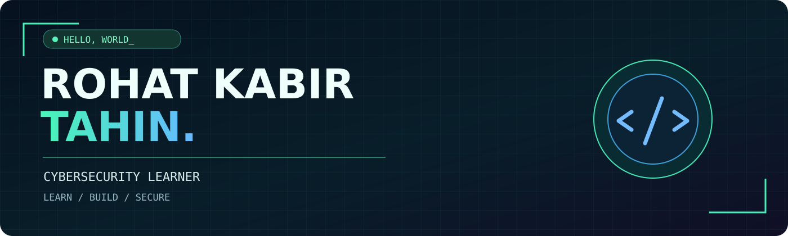

<div align="center">



### 👋 Hello, I'm Rohat Kabir Tahin

**Construction Technology graduate • Python & Cybersecurity learner**

[](https://github.com/tahin131)


</div>

## `> whoami`

I'm exploring software, networking and cybersecurity while building on my background in **Construction Technology (allied with Civil Technology)**. I believe in learning by building useful, responsible projects.

- 🐍 Currently learning **Python** and scripting
- 🌐 Exploring **networking, DNS, HTTP, ports and Linux**
- 🛡️ Interested in **defensive security** and ethical hacking labs
- 📍 Based in Bangladesh

## 🧩 My portfolio

This repository includes my personal website and portfolio resources.

- 🌐 [**Open the portfolio website**](index.html) — website source
- 📄 [**Curriculum Vitae**](Curriculum_Vitae_of_Rohat_Kabir_Tahin.pdf)
- 👤 [**GitHub profile**](https://github.com/tahin131)

## 🚀 Security learning roadmap

Projects below are **learning goals**, not claims of completed tools.

- [ ] Local-only Python port checker
- [ ] Beginner networking notes and DNS experiments
- [ ] Offline password-strength checker
- [ ] Everyday account security checklist

## ⚡ My approach

```text
[01] KEEP LEARNING
[02] BUILD SMALL PROJECTS
[03] TEST WITH PERMISSION
[04] DOCUMENT AND IMPROVE
```

<div align="center">

*From building structures to exploring digital security.*

</div>
